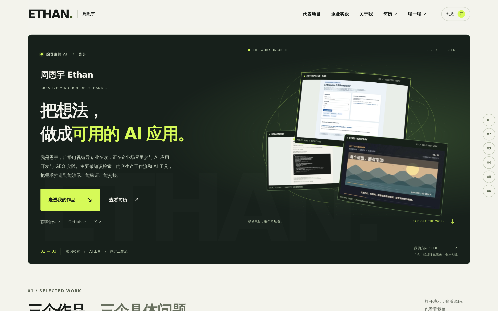

# ThreeUI 作品集改版 · 2026-10-27

基于内容重构后的 `main@d3859d9`，将首页变成展示真实项目的 3D 作品展台。原 GitHub Pages 地址、原生技术栈、项目事实、简历与联系方式继续沿用。

这是本次代码在自动化 WebKit 中的实际渲染截图，不是概念图。云预览浏览器没有 WebGL 上下文时会显示同位置的静态作品拼贴。实际发布状态以对应 PR、CI 和 Pages 部署为准。

## 访客看到的变化

- 首屏用炭黑、米白与酸绿建立主次；周恩宇 Ethan、编导生转 AI、AI 应用与工作流的方向直接可见。
- 三张真实作品截图变成曲面卡片：RAG、RelayAudit、视频工作流。轻微浮动、鼠标视角变化和原生滚动联动形成纵深。
- 作品、案例、源码、简历与联系入口都是普通 HTML 链接。访客无需操作 3D 场景才能看内容。
- 导航采用 ThreeUI AnimatedTopDock 的邻近反馈；只动文字，保持点击区域与键盘焦点位置。
- 项目图片、滚动出现与联系箭头有一致的微交互。RAG 三步案例继续按滚动展示材料、来源引用与拒答边界。
- 手机按一列阅读，仍有完整作品展台；系统减少动效、手动关闭或不支持 WebGL 时使用静态拼贴。

## 维护入口

| 目的 | 文件 |
| --- | --- |
| 个人介绍、项目数据 | `content/portfolio.json` |
| 首页结构和静态回退 | `content/home.template.html` |
| 首页视觉与响应式 | `home.css` |
| 3D 按需加载、偏好与可见性 | `hero-scene.js` |
| 曲面卡片、相机、纹理与渲染资源 | `public/js/threeui-gallery.js` |
| 导航微交互 | `dock.js` |
| 三步案例滚动 | `home.js` |
| 动效开关、图片弹窗 | `script.js` |

修改模板或 JSON 后运行 `npm run build`。不要只编辑生成的 `index.html`。三个 3D 纹理复用原站的 640px preview，场景不创建新项目事实、模型评测或客户成绩。

## 开源来源

- ThreeUI Community，固定提交 `68802d5428071ada5c20db8094b1649e6bb770ed`：Gallery 和 AnimatedTopDock 的原生适配，MIT。
- Three.js r186：按实际 exports 打包的本地模块，536,219 bytes；本地 gzip 133,616 bytes。MIT。固定工具版本与源哈希可复现。
- GSAP / ScrollTrigger 3.15.0：沿用既有本地版本及 Standard No Charge License。

完整许可证、来源路径与复现命令见 `THIRD_PARTY.md` 及 `public/vendor/threeui/`、`public/vendor/threejs/`。没有迁移 React，也没有使用 ThreeUI Pro/Beta 或外链演示媒体。

## 验证与边界

本地验收：静态构建与 14 页结构检查通过；Chromium/WebKit 的 56 个页面组合及 4 组导航交互通过；14 组布局及 10 组体验检查通过；两个引擎各 9 组 ThreeUI 检查通过。CI 执行相同门禁并保留报告。

新测试观察实际 WebGL 绘制调用，检查暂停／恢复、静态回退、桌面与手机像素上限、可选资源失败、键盘焦点和导航命中区。Chromium 使用软件 WebGL；headless 环境不产生真实标签隐藏时，报告明确记录注入的 visibility 事件。手机为模拟视口；WebKit 的手机测试用受支持的原生键盘滚动输入，不冒充实体触屏手势。

这些检查说明本次网页的行为和回退路径可用，不构成实体手机帧率、现场 Core Web Vitals、真实用户 INP 或 AI 项目质量评估。RAG 合成资料与抽取式演示、RelayAudit 无法证明模型身份、视频为原创程序动画的范围说明均保留。
